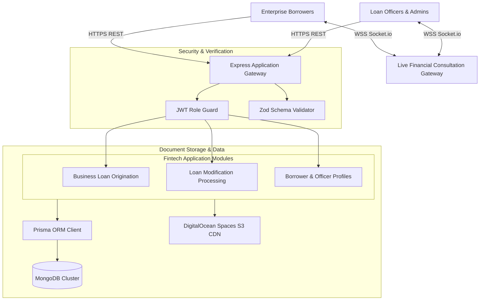

# Swazzaben Backend - Commercial Lending & Loan Modification API

<p align="center">
  
</p>

<p align="center">
  <a href="https://nodejs.org"></a>
  <a href="https://expressjs.com"></a>
  <a href="https://www.typescriptlang.org"></a>
  <a href="https://www.prisma.io"></a>
  <a href="https://www.mongodb.com"></a>
  <a href="https://socket.io"></a>
  <a href="LICENSE"></a>
</p>

---

## 📖 Overview

**swazzaben_backend** is Swazzaben Backend (`swazzaben_backend`) is a financial technology API built with Express.js, TypeScript, and Prisma ORM with MongoDB. The system streamlines commercial business loan applications, multi-tier loan modification requests, document verification, and live broker-to-applicant advisory chat via Socket.io.

---

## ⚡ Key Features

- 💼 **Commercial Loan Origination:** Comprehensive business loan submission pipeline capturing entity revenue, credit, and funding requested.
- 📑 **Loan Modification Engine:** Structured workflows for existing borrowers requesting rate adjustments, term extensions, or restructuring.
- 💬 **Live Broker Advisory Chat:** Instant WebSocket messaging connecting financial advisors directly with enterprise borrowers.
- 🛡️ **Role-Based Financial Security:** Granular access controls segregating Borrowers, Loan Officers, and Super Administrators.
- ☁️ **DigitalOcean Spaces Document Storage:** Secure S3-compatible document uploads for bank statements and tax filings.
- 📊 **Application Status Auditing:** Complete history log of underwriting reviews, approval milestones, and disbursements.

---

## 🏗️ System Architecture



---

## 📂 Directory Structure

```text
.
├── src/
│   ├── app/
│   ├── components/
│   └── ...
├── assets/
│   └── banner.svg
├── .env.example
├── .gitignore
├── package.json
├── README.md
└── LICENSE
```

---

## 🛠️ Tech Stack & Dependencies

| Layer / Library | Version | Description |
|---|---|---|
| **Express.js** | `v4.21` | HTTP routing and middleware framework |
| **TypeScript** | `v5.x` | Type safety and interface contracts |
| **Prisma ORM** | `v6.x` | MongoDB modeling and query engine |
| **Socket.io** | `v4.8` | Real-time client-to-officer consultation chat |
| **AWS SDK (S3 Client)** | `v3.x` | DigitalOcean Spaces file and document uploads |
| **Bcrypt.js** | `v2.4` | Cryptographic password hashing |

---

## ⚙️ Environment Variables

Create a `.env` file in the project root based on the provided sample:

```bash
cp .env.example .env
```

Configurable variables:

```env
PORT=5000
NODE_ENV=development
DATABASE_URL=mongodb+srv://<username>:<password>@cluster.mongodb.net/swazzaben_db?retryWrites=true&w=majority

JWT_SECRET=super_secret_jwt_key
JWT_EXPIRES_IN=7d
REFRESH_TOKEN_SECRET=super_secret_refresh_token
REFRESH_TOKEN_EXPIRES_IN=30d

# DigitalOcean Spaces S3
DO_SPACES_ENDPOINT=https://nyc3.digitaloceanspaces.com
DO_SPACES_KEY=your_do_spaces_key
DO_SPACES_SECRET=your_do_spaces_secret
DO_SPACES_BUCKET=swazzaben-docs

# CORS
CORS_ORIGIN=http://localhost:3000,http://localhost:3001
```

---

## 🚀 Getting Started

### Prerequisites

- Node.js (v20.x or higher recommended)
- Package Manager (`npm`, `yarn`, or `pnpm`)

### Installation

```bash
# Clone repository
git clone https://github.com/shahjalal-labs/swazzaben_backend.git
cd swazzaben_backend

# Install dependencies
npm install
```

### Running Locally

```bash
# Start development server
npm run dev
# or for backend services
npm run start:dev
```

### Building for Production

```bash
# Create production build
npm run build

# Start production server
npm start
```

---

## 📄 License

This project is licensed under the [ISC License](LICENSE).
